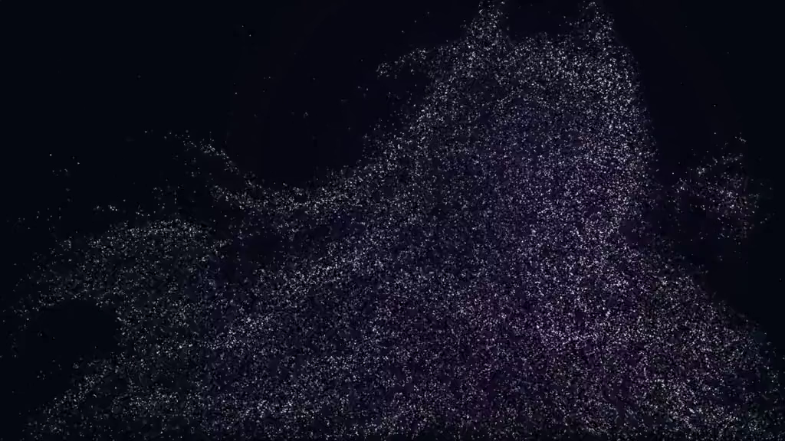

# AI App Boot

给 **Codex 和腾讯 WorkBuddy** 添加视频启动动画。打开片头的同时启动所选应用；**完整播完视频，并确认应用内部页面已经就绪，才关闭片头。** 应用加载较慢时停留在最后一帧，Esc 可跳过。

Windows 独立启动器，提供两款应用的入口，自动寻找安装位置。支持自定义 MP4、静音、窗口大小跟随。保留应用原有背景和主题，无需修改安装包；DreamSkin 可选。



## 下载使用

1. 下载 [最新版本](https://github.com/zhuze580/ai-app-boot/releases/latest) 的 `AI-App-Boot-Windows.zip`，解压到固定目录。
2. 安装 [Node.js 22 或更新版本](https://nodejs.org/)，以及 [Google Chrome](https://www.google.com/chrome/)。目标应用需要提前安装并完成登录。
3. 双击 **Codex.vbs** 或 **WorkBuddy.vbs**，启动对应应用与动画。

**下载即带原 Codex 开场视频**：约 14.2 秒，保留扫描圆环、粒子、人物、原文字和声音，Codex / WorkBuddy 共用这段片头。无需另找素材。可替换 assets/intro.mp4；支持 H.264/AAC、1–60 秒、最大 32 MiB。不同窗口比例使用黑边保留完整画面。

**仅使用本项目提供的入口才播放片头。** 应用原来的开始菜单、任务栏和桌面入口不会自动改变。若需要桌面快捷方式，可执行下面的 Install 命令。

## 命令

在项目目录打开 PowerShell。无需 npm install。

```powershell
# 检查本机应用、Node、Chrome 和视频
powershell.exe -NoProfile -ExecutionPolicy Bypass -File .\launch.ps1 -App Codex -Action Check
powershell.exe -NoProfile -ExecutionPolicy Bypass -File .\launch.ps1 -App WorkBuddy -Action Check

# 独立预览，不启动任何目标应用
powershell.exe -NoProfile -ExecutionPolicy Bypass -File .\launch.ps1 -Action Preview

# 启动目标应用及视频
powershell.exe -NoProfile -ExecutionPolicy Bypass -File .\launch.ps1 -App Codex
powershell.exe -NoProfile -ExecutionPolicy Bypass -File .\launch.ps1 -App WorkBuddy

# 可选：为两款应用分别创建桌面动画入口
powershell.exe -NoProfile -ExecutionPolicy Bypass -File .\launch.ps1 -App Codex -Action Install
powershell.exe -NoProfile -ExecutionPolicy Bypass -File .\launch.ps1 -App WorkBuddy -Action Install

# 移除自己创建的快捷方式
powershell.exe -NoProfile -ExecutionPolicy Bypass -File .\launch.ps1 -App WorkBuddy -Action Remove

# 单元测试
powershell.exe -NoProfile -ExecutionPolicy Bypass -File .\launch.ps1 -Action Test
```

启动命令加 `-Muted` 可静音。移动项目目录后，需重新安装快捷方式。

## 找不到应用时

自动发现 Microsoft Store Codex、正在运行的对应应用、开始菜单入口、卸载注册表和常见安装目录。便携安装或非标准位置可以手动指定：

```powershell
powershell.exe -NoProfile -ExecutionPolicy Bypass -File .\launch.ps1 -App WorkBuddy -AppPath 'E:\Apps\WorkBuddy\WorkBuddy.exe'
```

或者将 `config.example.json` 复制为 `config.local.json`，再配置对应应用：

```json
{
  "volume": 0.65,
  "muted": false,
  "apps": {
    "Codex": {},
    "WorkBuddy": { "appPath": "E:\\Apps\\WorkBuddy\\WorkBuddy.exe" }
  }
}
```

`media` 可指定 assets 内的视频文件名。config.local.json 不提交 Git。

## 就绪判断与限制

使用 Windows 原生辅助功能接口检查对应进程的真实窗口：内部页面需出现可编辑输入区域及已知导航按钮，连续两次确认后判为就绪。只检查控件角色、状态和导航标签，不读取聊天内容、输入值或账户信息。目标应用无需开启远程调试端口。

若本机已有 DreamSkin，Codex 重新创建窗口后可能暂不提供辅助功能控件；此时仅复用其已经存在、且端口进程身份与安装路径均验证匹配的本地连接，检查主页面和编辑区是否存在，不读取聊天内容。不连接桌宠页面，不额外开启端口。

v1.0.1 起，主窗口与桌宠覆盖窗口分别识别。窗口关闭但进程仍在时，恢复真正的主窗口；动画结束后恢复并激活它。片头移除非客户区边框和圆角，按实际客户区像素覆盖目标外框，避免四周露出应用。

首次安装、登录页、网络失败或应用版本更改导致控件无法识别时，视频会停在末帧，可按 Esc 跳过。检查通过只代表依赖可用；应用版本升级后仍需实际验证就绪识别。仅支持 Windows 10/11 桌面版，不适用于网页或 macOS/Linux。

Chrome 使用本项目独立的临时配置，不接触个人浏览器配置。运行记录在 `%LOCALAPPDATA%\AIAppBoot\last-codex.json` 或 `last-workbuddy.json`。片头跟随真实应用窗口的位置与尺寸，只改变片头窗口。已有 DreamSkin 时尽量沿用其配置；普通安装不依赖 DreamSkin。

## 在 Codex / WorkBuddy 中开发

用任意工具打开项目目录，先阅读 AGENTS.md；WorkBuddy 另有 WORKBUDDY.md。执行 `npm test`；Windows 上可执行 `npm run test:browser` 进行真实 Edge 视频及播放器生命周期测试。

本机实际窗口测试：`powershell.exe -NoProfile -ExecutionPolicy Bypass -File tests/smoke.ps1 -App Codex`，App 可换成 WorkBuddy，加 `-Delayed` 检查末帧等待。`npm run test:fail-open` 检查无 Chrome 和片头渲染器卡死的放行行为，需要安装并登录 WorkBuddy。上述实际应用测试会显示动画及应用窗口，不纳入无人值守 CI。

结构：`launch.ps1` 统一入口，`scripts/apps.ps1` 应用适配器，`scripts/host.ps1` 原生窗口监控，`scripts/Native.cs` 辅助功能和窗口 API，`src/boot.mjs` 播放会话，`src/player.js` 视频覆盖层，`assets` 视频素材，`tests` 测试。

## 许可证

项目代码使用 MIT 许可证。默认 intro.mp4 为用户提供并明确要求随项目分发的原开场裁切视频，其人物、音乐等权利属于各自权利人，不属于 MIT 授权；本仓库不授予额外商业使用或再许可权利。素材信息见 assets/README.md 与 intro.json。Codex、WorkBuddy 及其商标属于各自权利人，本项目是独立工具。
